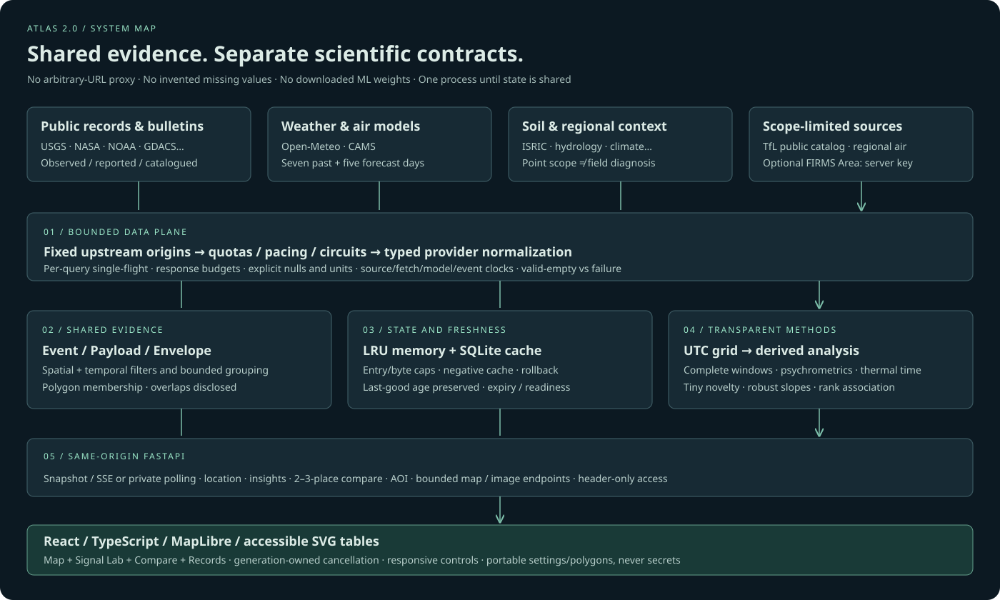

# ATLAS 2.0 — Earth Intelligence

### Public-source geospatial evidence. Small, transparent models. No false certainty.

A complete **local-first Python + React application** combining environmental analysis and multi-source mapping. Inspired by a deep, read-only review of TerraWatch and OSIRIS; an original integration, not an official port or endorsement. Neither upstream repository, dataset nor model collection was cloned.

> **Lean deployment edition:** generated screenshots, raw test logs, sample API dumps and duplicate printable handovers have been removed. Application source, build assets, dependency locks, tests, licences and operating/method guides are retained. See [cleanup and deployment notes](docs/LEAN_DEPLOYMENT.md).

## What is new in 2.0

- **Signal Lab:** 24/48/72-hour precipitation/reference ET₀ balance, dew point, vapour-pressure deficit, configurable capped thermal accumulation, wind rose and source-completeness counts.
- **Small interpretable models:** seven-day diurnal/MAD/shrinkage novelty analysis, Theil–Sen trend descriptors and timestamp-aligned Spearman associations. No downloaded weights, GPU or LLM oracle.
- **Compare two or three places:** one shared UTC clock, comparable model windows, four curves and canonical exports—no invented “safest city” ranking.
- **Record explorer:** time/type/source/priority distributions, bounded USGS magnitude–depth plot, searchable/paginated records and CSV.
- **Area authoring:** draw, undo, finish or import a bounded WGS84 GeoJSON polygon; filtered membership reports, camera fitting, saved polygons and portable workspace JSON.
- **Responsive controls:** smartphone bottom tool rail, dismissible layer drawer, container-sized charts, table alternatives, unit/density/reduced-motion preferences and keyboard inspection.
- **Hardening:** cancellation-owned requests, recovered-error cleanup, schema/unit/UTC validation, null-preserving science, stronger cache/SQLite boundaries and lazy map/analysis bundles.

Existing features remain: vector map/3D globe, NASA imagery, soil predictions/quantiles, explicit erosion scenarios, event-time filtering, public TfL camera snapshots, regional aircraft, CISA reference advisories and a source/attribution registry.

## Run on your own system

**Supported: Python 3.11–3.13 + Node 20–24 LTS (tested on Python 3.11.2 / 3.13.16 and Node 22.22.3 / 24.21.0).**

```sh
cd atlas
./scripts/setup.sh
./scripts/run.sh
# Open http://127.0.0.1:7860
```

If an extractor loses executable permissions, use `bash scripts/setup.sh` and `bash scripts/run.sh`.

Windows PowerShell:

```powershell
.\scripts\setup.ps1
.\scripts\run.ps1
```

A **release ZIP includes the built frontend**. For runtime-only use, Node is unnecessary:

```sh
python3.13 -m venv .venv
.venv/bin/python -m pip install --require-hashes -r backend/requirements.txt
./scripts/run.sh
```

Full platform instructions, developer workflow, Docker alternative and troubleshooting: **[Local run guide](docs/LOCAL_RUN.md)**. Scripts bind to loopback by default. Fresh data/maps need internet access; this is not a fully offline archive.

## Release verification (recorded 10 October 2026; updated 18 October 2026)

| Gate | Recorded v2 result |
|---|---|
| Offline tests | **226 backend + 79 frontend = 305 passed** (zero warnings) |
| Browser flows | **36 passed**: 13 v2, 13 retained-feature, 7 private-access and 3 controlled failure/recovery checks |
| Responsive matrix | **72 viewport/view/browser samples**: 12 sizes × 2 views × Chromium, Firefox and WebKit |
| Viewports | 320–2560 CSS px wide, portrait/tablet/desktop and short landscape |
| Automated accessibility | **Zero axe violations** in 8 sampled Chromium page states; not a WCAG certification |
| Map engines | Real map rendering in all 3 tested engines; Firefox used a headed virtual display for software WebGL |
| Real model probe | 288 hourly rows/provider; complete 72-hour windows and a usable short baseline at the tested point |
| Linux setup/build | Actual setup script and production build executed on Python 3.11.2 / 3.13.16 and Node 22.22.3 / 24.21.0 |
| Static & lint checks | Full Ruff suite (`ruff check backend scripts`), strict TypeScript (`tsc -b`), `pip check` |
| Production dependency audits | No known vulnerabilities reported at check time; not a security guarantee |

See **[Validation](docs/VALIDATION.md)** for the retained summary, reproduction commands and exclusions. Bulky historical artifacts remain available in Git tag `v2.0.0`, not in this lean working tree. Browser viewport emulation is not physical-device/GPU testing. Native Windows/macOS execution, Docker execution, production load/soak testing and scientific forecast-skill calibration are not claimed.

## Sources and account requirements

**23 adapters**, with 10 default collectors and others on demand. Counts represent provider records, not unique disasters or independent sensor networks. Empty, unknown, stale, unavailable, modeled and observed states are distinguished; **no synthetic live fallback records** are displayed.

- Default public/keyless paths work without creating an ATLAS account.
- NASA FIRMS **Area API** optionally needs a free server-side MAP_KEY; the default South Asia feed is keyless.
- The free hosted **Open-Meteo APIs are non-commercial**. MIT code licensing does not override provider terms or quotas.
- ISRIC can be slow, incomplete or return valid no-data. SoilGrids is regional model context, not a laboratory/farm diagnosis.
- GDELT was unavailable during recorded sampling; optional keyed FIRMS was not tested with a real key. Provider availability can change.

Details: **[API/account guide](docs/API_GUIDE.md)** and **[third-party notices](THIRD_PARTY_NOTICES.md)**.

## Scientific boundaries

ATLAS derives quantities from available provider data; it does not invent missing values. P−ET₀ is an atmospheric reference balance, **not irrigation need or soil-water storage**. Thermal accumulation is assumption-dependent, **not a crop-stage/yield forecast**. Short-baseline novelty is **not disaster probability, climate anomaly or independent validation**. Proximity groups and cross-source record counts are **not corroboration**. Event-time filtering is **not archived historical replay**.

Every new method has an explicit contract, formula, coverage rule, test scope and limitation in **[Model cards](docs/v2/MODEL_CARDS.md)**. Existing soil, fire-weather and erosion assumptions remain in [Scientific methods](docs/SCIENTIFIC_METHODS.md).

## Architecture and engineering

- FastAPI + shared typed event/envelope contracts; bounded HTTP gateways, per-query single-flight, negative caches and quota/circuit-breaker policies.
- Byte/entry-bounded memory + SQLite persistence, original last-good clocks, transactional rollback and no arbitrary-URL proxy.
- Bounded spatial/time candidate indexing, date-line-aware polygons and position lifetimes.
- NumPy for small transparent calculations; independent fast weather/AQI and slower soil loading.
- React/TypeScript + MapLibre + local fonts; same-origin requests, worker bundling, accessible data tables and portable allowlisted workspace settings.
- Optional header-only private deployment access; key stays in page memory and out of local storage/workspace exports. One application worker until shared collector/quota state is implemented.



## GitHub publication

**Source is publication-ready locally; no remote push is claimed in this handover.** An authenticated GitHub destination was unavailable in the build environment.

On your own computer, authenticate with the official CLI and publish the reviewed project:

```sh
gh auth login
python scripts/publish_github.py YOUR_ACCOUNT/atlas-earth-intelligence --public
```

The helper asks for confirmation and refuses an unrelated Git root/existing origin. Never paste tokens into chat. Full instructions: **[Publish to GitHub](docs/GITHUB_PUBLISH.md)**. GitHub Pages cannot run the Python backend; source publication and application hosting are different actions.

## Documentation

| Guide | Contents |
|---|---|
| [V2 ground-level audit](docs/v2/AUDIT_REPORT.md) | Actual defects, fixes, evidence and deliberate non-features |
| [Upstream review](docs/UPSTREAM_AUDIT.md) | 552 selected text files / 102,621 lines triaged, pinned revisions and read-only review boundaries |
| [Architecture](docs/ARCHITECTURE.md) | Contracts, modules, ingestion and scaling limits |
| [Model cards](docs/v2/MODEL_CARDS.md) | New transparent calculations and statistical methods |
| [API guide](docs/API_GUIDE.md) | Providers, quotas, accounts and analysis endpoints |
| [Local run](docs/LOCAL_RUN.md) / [Deployment](docs/DEPLOYMENT.md) | Local-first launch and production responsibilities |
| [Security](docs/SECURITY.md) | Threat model, controls and residual risks |
| [Validation](docs/VALIDATION.md) | Executed checks versus untested boundaries |
| [GitHub publication](docs/GITHUB_PUBLISH.md) | Safe account-owned publication workflow |

```text
backend/atlas_app/     API, providers, ingestion, cache, geometry and numerical methods
backend/tests/        offline regression suite
frontend/src/         React/TypeScript application, hooks, charts and tests
frontend/scripts/     reproducible browser checks
frontend/dist/        built UI in the release ZIP (ignored in Git)
docs/                 method/audit guides and recorded evidence
scripts/              setup, run, check, publication and packaging helpers
.github/workflows/    CI definitions; run them in your own repository
```

Original ATLAS code: **MIT**. Dependencies, map assets and provider data retain their own licenses. The distribution excludes real credentials, runtime databases, dependency folders, bulk datasets and both upstream source trees.
