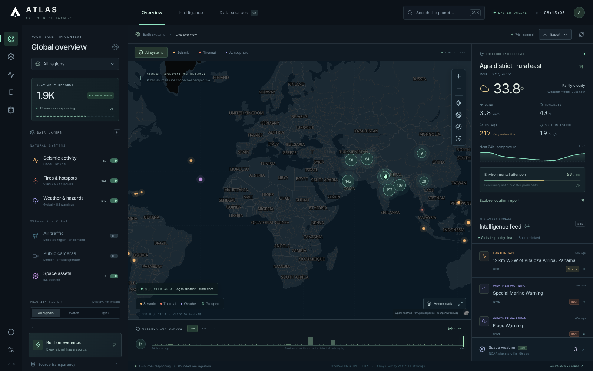
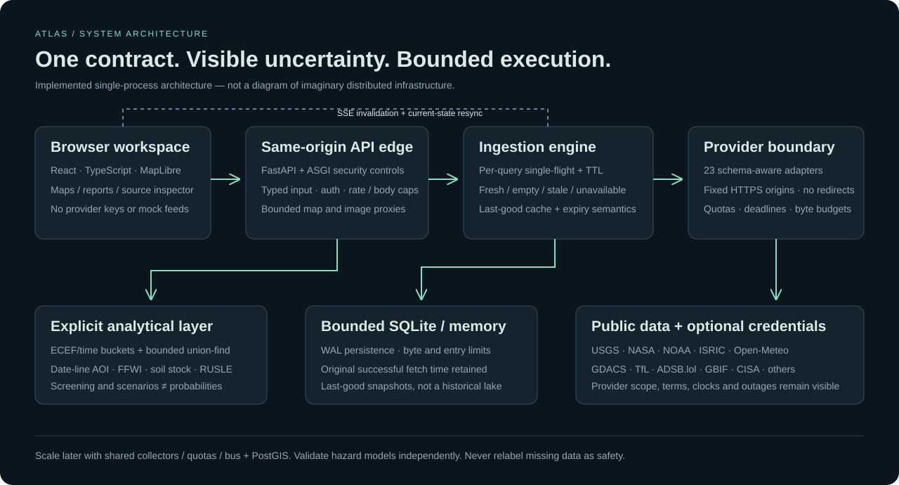

# ATLAS — Earth Intelligence

### TerraWatch × OSIRIS, rebuilt around evidence.

**Working application + live demonstration + complete source handover.**

Dono repositories ko **read-only** inspect kiya gaya—git clone, unke datasets/weights copy ya upstream applications execute nahi kiye gaye. Environmental analysis aur multi-source geospatial workspace ko ek original, cohesive project mein combine kiya gaya hai. Ye sirf blueprint nahi: actual backend, frontend, API adapters, calculations, exports aur tests included hain.

**Live:** Arena ka **“ATLAS — Earth Intelligence”** preview kholo. Service port **7860** par chalti hai. Preview temporary workspace hosting hai; apne server par deploy karne ke liye source, compiled frontend aur setup instructions saath hain.



## At a glance

| Deliverable | What is included |
|---|---|
| Read-only upstream review | 552 selected text files / 102,621 lines triaged, pinned revisions, focused source-level findings |
| Source integrations | **23 implemented adapters**; 10 default collectors, others on demand |
| Keyless access | 22 keyless adapter paths; 21 returned usable responses across live checks; GDELT was unavailable |
| Optional credentials | NASA FIRMS Area MAP_KEY, server-side; no account/key was invented |
| Offline verification | **132 backend tests + 27 frontend tests passed** |
| Browser verification | **19 browser checks passed**: 13 desktop/mobile flow checks + 6 private-access/restore/image checks |
| Dependency audits | No known production vulnerabilities reported at check time—not a security guarantee |
| Handover | Code, hash/lock files, built frontend, reports, OpenAPI, Docker/Compose and CI definitions |

Counts are different kinds of records/adapters, not independent sensor networks or unique disasters. The application does not claim continuous availability of every provider.

## Explore the live application

1. **Overview:** real vector map, optional 3D globe, observation layers, display-priority filters and event-time windows. Click a record to inspect its original source.
2. **Location:** search a named place or type `latitude, longitude`. Current modeled conditions load independently of the slower soil service. The default is explicitly **Agra district · rural east**, not an inferred precise user location.
3. **Intelligence:** evidence brief, soil properties and prediction quantiles, weather/river context, environmental datasets, explicit RUSLE scenarios, and CISA reference advisories.
4. **Regional layers:** enable aircraft for the selected region; choose Greater London to explore the official TfL public-camera catalog. Snapshots are not live video; capture time is unknown.
5. **Area analysis:** zoom into a region, then choose **Analyze visible area**. Arbitrary bounded polygons/holes are also supported by the API.
6. **Exports:** download the current filtered view as GeoJSON, JSON or spreadsheet-safe CSV. Save named location views locally in this browser.
7. **Data sources:** inspect coverage, fetch age, observation/model nature, licensing, optional credentials and real errors. No synthetic live fallback data is displayed.

## What makes this more than a feed dashboard

- A shared `Event / Payload / Envelope` contract across providers, with distinct fetch, attempt, upstream and record times.
- Valid-empty responses replace old records; error fallback retains the original successful timestamp and expires.
- Per-query single-flight, bounded memory/SQLite caches, negative caching, provider-family quotas, circuit breakers and cancellation isolation.
- ECEF spatial cells + time buckets + haversine checks + union-find for **bounded proximity grouping**, rather than an unrestricted all-pairs join. Proximity is not corroboration.
- Date-line-aware, boundary-inclusive polygon membership with validated holes/topology and workload caps.
- Completed-hour rainfall, unit-correct FFWI, explicitly derived soil stock and a separately labeled assumption-driven erosion calculator.
- Same-origin provider access, no arbitrary-URL proxy, header-only optional auth, memory-only browser key, body/inflight limits, safe exports and bundled local UI assets.
- Honest gaps: no fabricated NDVI, soil nutrients, flood/landslide probability, return period, aircraft track, camera feed or historical replay.



## Read the full breakdown

| Document | Contents |
|---|---|
| [Upstream audit](docs/UPSTREAM_AUDIT.md) | Pinned revisions, actual scope, file/line evidence, strengths, defects and merger decisions |
| [Architecture](docs/ARCHITECTURE.md) | Modules, dataflow, contracts, budgets, spatial algorithms, cache/SSE lifecycle and scaling boundary |
| [Scientific methods](docs/SCIENTIFIC_METHODS.md) | Exact formulas, weights, units, uncertainty, model limitations and validation requirements |
| [API/account guide](docs/API_GUIDE.md) | All 23 adapters, quotas/coverage, licensing, free MAP_KEY instructions and explicitly unimplemented extensions |
| [Security/privacy](docs/SECURITY.md) | Controls, threat model, credentials, query privacy and residual risks |
| [Deployment](docs/DEPLOYMENT.md) | Run scripts, Docker, ingress, configuration, backups, tests, monitoring and release gates |
| [Validation](docs/VALIDATION.md) | Executed checks, live successes/failures, artifacts and untested boundaries |
| [Third-party notices](THIRD_PARTY_NOTICES.md) | Software, map/style/font and provider attribution |

## Run it on your chosen server

Recommended/verified build environment: **Python 3.13 + Node 24 LTS**.

```sh
# From the extracted project root:
./scripts/setup.sh
./scripts/run.sh
# Then open http://localhost:7860 on that machine.
```

For the included prebuilt frontend, Node is not needed just to run the Python server:

```sh
python3 -m venv .venv
.venv/bin/python -m pip install --require-hashes -r backend/requirements.txt
./scripts/run.sh
```

Optional Docker workflow: `docker compose up --build -d`. The container configuration is delivered but **was not built here** because this workspace had no Docker daemon. Review [deployment instructions](docs/DEPLOYMENT.md) before exposing it publicly.

### Optional NASA credential

The default NOAA-20 South Asia detections work without an account. For the additional area-query adapter, obtain a free NASA MAP_KEY, set `ATLAS_FIRMS_MAP_KEY` on the server and restart. See [API/account guide](docs/API_GUIDE.md). Other account-based services in that guide are labeled future extensions, not already connected integrations.

### Verify

```sh
./scripts/check.sh
# With the live application already running:
cd frontend
npx playwright install --with-deps chromium
node scripts/verify-browser.mjs
```

Open `/docs` on the running application for the local API reference; `/api/openapi.json` provides its schema. Unit fixtures are deliberately offline and never imported by production code.

## Important, honest boundaries

- **Production-oriented implementation, not a production-readiness certificate.** Public hosting still needs TLS/ingress/identity/egress setup, a real container build, workload/soak/restore testing and proportionate security/accessibility review. Run one application worker until shared collector/quota/bus state is implemented.
- **Scientific screening is not a disaster probability.** Soil is a regional-context static model; ISRIC advises against farm-level interpretation. Derived stock is not its separately trained stock product. Confirm consequential decisions with appropriate authorities/domain evidence.
- **Free does not always mean commercial.** The free hosted Open-Meteo service is non-commercial. ISRIC beta REST is limited to five calls/minute; ATLAS applies conservative per-process pacing. Camera, news and map reuse have their own terms. See [API guide](docs/API_GUIDE.md).
- **Outages remain visible.** GDELT was unavailable in live checks. Some uncached SoilGrids requests can be slow, partial or unavailable; a valid no-data urban cell remains null rather than borrowing a rural value. The keyed FIRMS path remains unverified without a real key.
- **Not a literal full port of two monorepos.** Maritime AIS, global orbital fleets/CCTV catalogs, trained crop-health pipelines, autonomous predictive agents, historical data lakes and multi-tenant identity are explicitly outside this delivered version. No disabled feature is padded with mock “live” records.

## Project layout

```text
backend/atlas_app/      API, adapters, ingestion, storage, spatial and scientific code
backend/tests/         offline regression suite
frontend/src/          complete React/TypeScript workspace
frontend/public/       local geographic/style assets and licenses
frontend/dist/         compiled frontend in the release archive (regenerable)
frontend/scripts/      actual browser review / verification scripts
docs/                  audit, architecture, methods, guides and verification evidence
scripts/               setup, run, checks, packaging and read-only review utility
deploy/                example HTTPS ingress
.github/workflows/     CI definitions (not run in a user account)
```

The release excludes `.env`, `.runtime`, dependency folders, downloaded model/data collections and original repository trees. MIT applies to the original ATLAS code; dependencies, basemap designs and provider data retain their own licenses.
